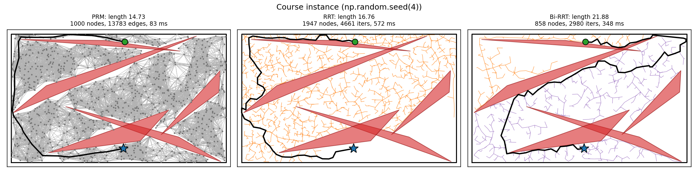
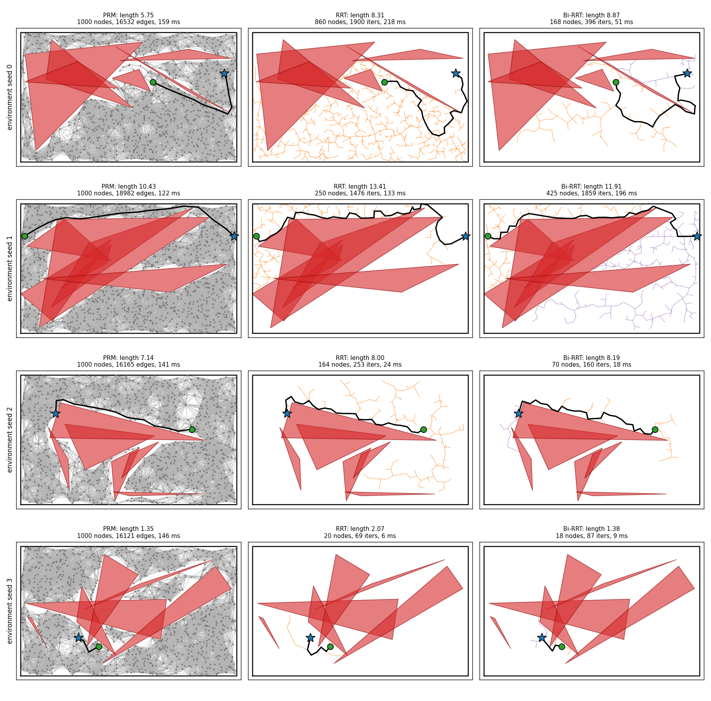
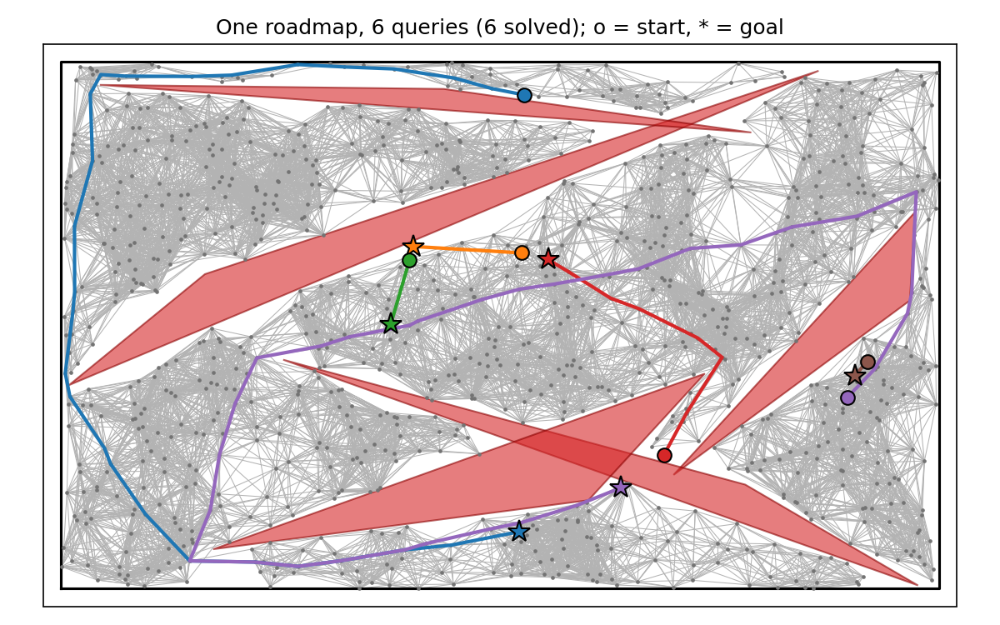
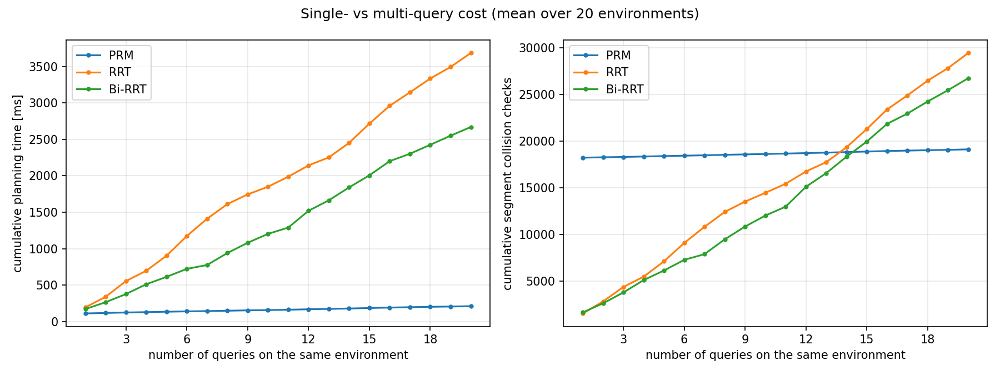
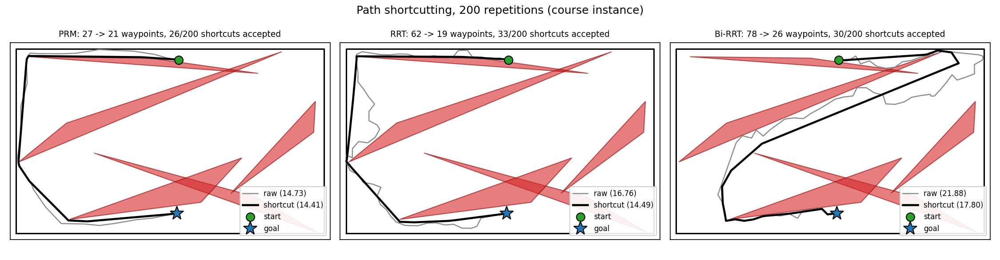
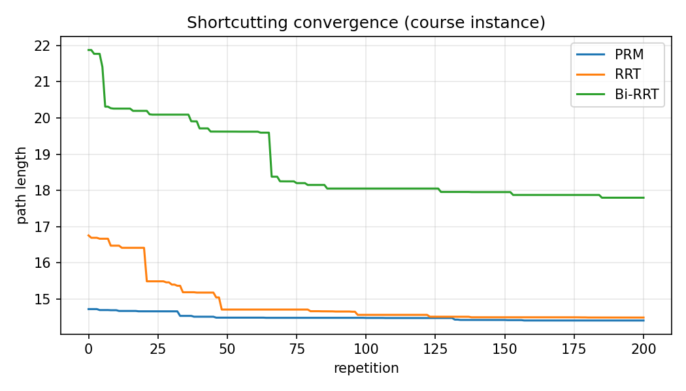

# planner2d: sampling-based path planning and shortcutting in 2D

Solutions to the two motion-planning exercises from the
[osrobotics course](https://crigroup.gitbooks.io/osrobotics/content/):

1. **[Path planning](https://crigroup.gitbooks.io/osrobotics/content/planning/path_planning.html)**:
   PRM and RRT (plus bidirectional RRT-Connect) on the 2D triangular-obstacle environment,
   tested on several environments and queries, with a single- vs multi-query running-time comparison.
2. **[Post-processing](https://crigroup.gitbooks.io/osrobotics/content/planning/post_processing.html)**:
   the `PATH_SHORTCUTTING` algorithm applied to the paths found in exercise 1.



## Quick start

```bash
pip install -e ".[dev]"     # Python >= 3.10; installs numpy, scipy, matplotlib, pytest, ruff

python scripts/exercise1_path_planning.py     # figures/ex1_*.png
python scripts/exercise2_post_processing.py   # figures/ex2_*.png + length statistics
python scripts/benchmark.py                   # results/benchmark.{md,csv} + figure (~1 min)

pytest                                        # 49 tests, ~15 s
```

All scripts are deterministic: environments are generated exactly as in the course snippet
(`np.random.seed(seed)` then `Environment(10, 6, 5)`), and every planner takes its own seeded
`np.random.Generator`. `make_scenario(4)` reproduces the instance shown in the course notes.

Minimal use of the library:

```python
import numpy as np
from planner2d import PRM, BiRRT, CollisionChecker, shortcut_path
from planner2d.scenarios import make_scenario

env, (query,) = make_scenario(4)
checker = CollisionChecker(env)

prm = PRM(checker, n_samples=1000, radius=0.8, rng=np.random.default_rng(0))
prm.build()                                  # once per environment
path = prm.query(query.start, query.goal)    # cheap; repeat for more queries

result = BiRRT(checker, rng=np.random.default_rng(0)).plan(query.start, query.goal)
short = shortcut_path(result.path, checker, max_repetitions=200).path
```

## Repository layout

```
planner2d/
  environment_2d.py   course environment, vendored unmodified from crigroup/osr_course_pkgs
  collision.py        CollisionChecker: the free-space oracle (points and segments, batched)
  prm.py              PRM: build() the roadmap once, query() many times (A* search)
  rrt.py              RRT (goal-biased) and BiRRT (RRT-Connect), sharing Tree / EXTEND / STEER
  shortcut.py         PATH_SHORTCUTTING
  geometry.py         arc-length helpers for piecewise-linear paths
  scenarios.py        reproducible environments and queries
  plotting.py         matplotlib helpers (explicit Axes, no global pylab state)
scripts/              one script per exercise, plus the benchmark
tests/                pytest suite
figures/, results/    generated outputs, committed so they can be viewed on GitHub
```

## Exercise 1: path planning

**PRM.** `build()` rejection-samples `n_samples` free configurations, finds all pairs closer than
`radius` with a KD-tree, and keeps the pairs whose straight segment is collision-free. `query()`
connects start and goal to every roadmap vertex within `radius` that they can see, then runs A*
with the Euclidean heuristic. Query vertices are kept in a temporary adjacency map, so the
roadmap is never mutated and can serve any number of queries.

**RRT.** Implements `BUILD_RRT` / `EXTEND` / `STEER` as written in the notes. `STEER` returns
`q_rand` if it is within `step_size`, otherwise the point `step_size` toward it, and fails if
that segment collides. Two practical additions: the goal is used as `q_rand` with probability
`goal_bias` (5%), and after each extension the tree tries a direct connection to the goal when
it is within one step.

**Bi-RRT.** The bidirectional variant the notes recommend, implemented as RRT-Connect (Kuffner
and LaValle, 2000): one tree extends toward a random sample, the other greedily `CONNECT`s toward
the new vertex, and the trees swap roles each iteration.

Other environments and queries (six obstacles to make them harder):



A single PRM roadmap answering six different queries on the course environment:



### Running-time comparison

`scripts/benchmark.py` runs all three planners on 20 environments with 20 queries each. PRM
builds one roadmap per environment and is charged for it on the first query; RRT and Bi-RRT
plan each query from scratch.



| Total time (ms) for the first k queries | k = 1 | k = 5 | k = 10 | k = 20 |
|---|---:|---:|---:|---:|
| PRM | 111 | 134 | 156 | 210 |
| RRT | 194 | 903 | 1849 | 3685 |
| Bi-RRT | 171 | 613 | 1202 | 2669 |

| Total segment collision checks | k = 1 | k = 5 | k = 10 | k = 20 |
|---|---:|---:|---:|---:|
| PRM | 18,223 | 18,397 | 18,617 | 19,113 |
| RRT | 1,561 | 7,130 | 14,464 | 29,420 |
| Bi-RRT | 1,670 | 6,154 | 12,030 | 26,724 |

| Over all 400 queries | success rate | mean length (solved) |
|---|---:|---:|
| PRM | 95.0% | 6.46 |
| RRT | 96.5% | 8.50 |
| Bi-RRT | 99.0% | 8.71 |

How to read this:

- **By algorithmic work, the textbook picture holds.** For one query, RRT needs about 12x fewer
  collision checks than building the roadmap. PRM's per-query cost is about 50 checks, so it
  breaks even after roughly 12 to 13 queries and wins clearly beyond that.
- **By wall-clock time, PRM wins even for a single query in this implementation.** That is an
  implementation effect, not an algorithmic one: PRM checks all of its ~18k candidate edges in
  one vectorised NumPy call, whereas RRT is inherently sequential (each extension depends on
  the previous tree) and pays Python overhead per iteration. In a compiled implementation, or
  with an expensive collision checker (a real robot arm), the work-based numbers are the better
  guide.
- **Bi-RRT is the most robust.** It solves 99% of queries and is about 30% faster than RRT,
  consistent with the notes' recommendation. PRM's failures happen in narrow passages that 1000
  uniform samples do not cover well; the course instance itself has several. Some queries may be
  genuinely unsolvable, since `random_query` only checks that start and goal are free.
- **PRM paths are shorter** because A* returns the shortest path in the roadmap, while RRT
  returns whichever path the tree happened to grow. Exercise 2 closes much of this gap.

## Exercise 2: path shortcutting

`shortcut_path` follows `PATH_SHORTCUTTING`: pick two arc-length positions `t1 < t2` uniformly
along the current path; if the straight segment `[q(t1), q(t2)]` is collision-free, splice it in.
By the triangle inequality the length can never increase, and because both endpoints lie on a
collision-free path the result stays collision-free. The tests check both properties. Pairs that
fall on the same segment are skipped, since that portion is already straight.





Over 30 random environments with 200 repetitions:

| planner | solved | raw length | shortcut length | reduction |
|---|---:|---:|---:|---:|
| PRM | 27/30 | 7.13 | 6.98 | 2.2% |
| RRT | 28/30 | 11.41 | 8.59 | 24.7% |
| Bi-RRT | 29/30 | 10.66 | 8.42 | 21.0% |

(Each row averages over the environments that planner solved, so compare reductions within a
row rather than raw lengths across rows.) Shortcutting matters most for the tree planners, whose
raw paths zig-zag at the scale of `step_size`. On the course instance most of the gain comes within the first 100 repetitions.
Shortcutting only improves a path within its homotopy class: in the course instance, Bi-RRT's
path goes around the right-hand side and stays there.

## Design notes

- **Exact segment collision checking.** The notes suggest sampling points along a segment. I
  check segments exactly instead: each triangle is the intersection of three open half-planes,
  so the portion of `a + t(b - a)` inside it is an interval in `t` with a closed-form solution.
  This cannot miss thin obstacle corners (on 40,000 random segments, 4,001-point sampling missed
  two real collisions that the exact test caught; the test suite checks the exact test never
  disagrees in the other direction), and it batches naturally: `segments_free(a, b)` checks
  thousands of segments in one call.
- **Same semantics as the course oracle.** Point checks reproduce
  `Environment.check_collision` exactly (verified on 20,000 points in the tests), including
  that obstacles are open sets, so their boundaries are free. Points outside the workspace are
  treated as in collision.
- **Planners depend only on `CollisionChecker`**, not on the environment class, so swapping in
  another environment means writing one class.
- **`environment_2d.py` is vendored byte-for-byte** so the repository runs standalone and the
  generated environments are exactly the course's. It is excluded from linting.
- Type hints throughout, `ruff` lint and format, and a GitHub Actions workflow running lint and
  tests on Python 3.10 and 3.12.

## Possible extensions

- A KD-tree or grid for RRT nearest-neighbour search (currently O(n) per query, which is fine
  for the few thousand nodes needed here).
- Lazy PRM (defer edge checks to query time) to cut the build cost for few-query use.
- Narrow-passage sampling (e.g. Gaussian or bridge-test sampling) for PRM.
- Trajectory shortcutting with velocity and acceleration bounds (second half of the
  post-processing chapter).
